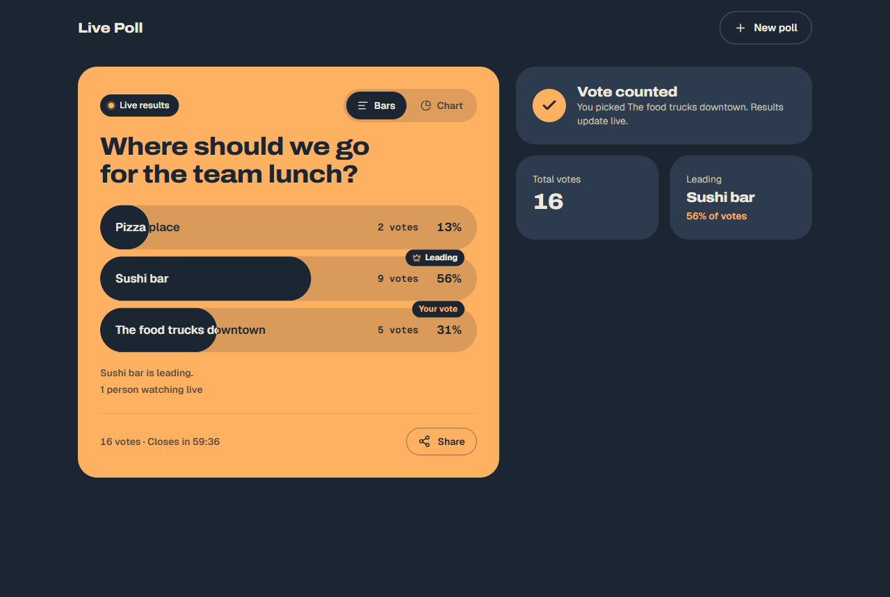

# Live Poll

A simple real-time poll app.
Create a poll, share the link, and watch the votes come in live.

**Try it:** https://poll-request.shahriarbijoy.workers.dev



## What it does

- You create a poll with 2 to 5 answers and a time limit, from 1 minute to 24 hours.
- You share one link. Anyone with it can vote once.
- Voters see the results right after they vote, and the results update live.
- You get a private link to close the poll early.

## Run it locally

You don't need a Cloudflare account or any API key. Everything runs on your computer.

You need Node 22 or newer and pnpm 10. If you have Node, `corepack enable` gives you pnpm.

```bash
git clone https://github.com/ShahriarBijoy/hubblr-live-poll.git
cd hubblr-live-poll
pnpm install
pnpm dev
```

Then open http://localhost:5173.

On Windows, clone into a short folder like `C:\code\hubblr-live-poll`. A very long folder path stops the local database from opening.

### Run it with an AI agent

Paste this prompt into Claude Code, Cursor, or Codex:

```text
Clone https://github.com/ShahriarBijoy/hubblr-live-poll and run it locally.

- It needs Node 22 or newer and pnpm 10. If pnpm is missing, run `corepack enable`.
- It needs no Cloudflare account, login, or API key. Do not run `wrangler login`,
  do not ask me for a token, and do not run `pnpm run deploy`.
- On Windows, clone to a short path such as C:\code\hubblr-live-poll. A long path breaks
  the local database.
- Run `pnpm install`, then start `pnpm dev` in the background and wait for the
  "Local:" URL it prints (usually http://localhost:5173).
- Check that it works: run the curl steps in documentation/api.md against that URL,
  and confirm the poll is created (201), the vote is counted (200), and the creator
  sees the counts.
- Run `pnpm check:slices`, `pnpm typecheck`, and `pnpm test`, and tell me the results.
- Then tell me the local URL so I can open it in my browser.
```

The repo also has a [CLAUDE.md](CLAUDE.md) that explains the code to an agent.

### Other commands

| Command | What it does |
| --- | --- |
| `pnpm test` | Runs the tests |
| `pnpm typecheck` | Checks the TypeScript types |
| `pnpm check:slices` | Checks that the code folders follow their rules |
| `pnpm build` | Builds the app for production |
| `pnpm demo:votes <url>` | Casts votes one by one on a poll, so you can watch the results update live |

## Tech stack

- **App:** TanStack Start, React 19, TypeScript
- **Server:** Cloudflare Workers, with one Durable Object per poll (each has its own SQLite database) and D1 for poll summaries
- **Live updates:** WebSockets
- **UI:** shadcn/ui (on Radix UI), Tailwind CSS 4, Motion
- **Data and validation:** TanStack Query, Zod
- **Tests and CI:** Vitest, GitHub Actions
- **Repo:** pnpm workspace

## More details

- [How it works](documentation/how-it-works.md): the screens, the architecture, and the data
- [API](documentation/api.md): every endpoint, with curl examples
- [Security](documentation/security.md): how votes and links are protected
- [Scaling and cost](documentation/scaling-and-cost.md): load test results, monthly cost, and known limits
- [Decisions](documentation/decisions.md): assumptions, and the goals added to the brief
- [Deploy](documentation/deploy.md): putting it on Cloudflare
- [How AI was used](documentation/ai-usage.md)
