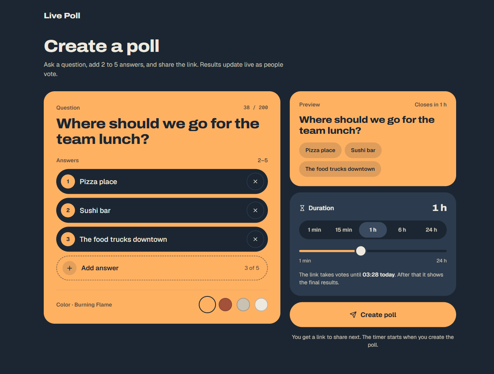
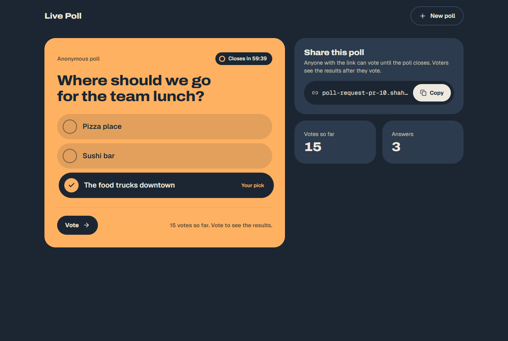
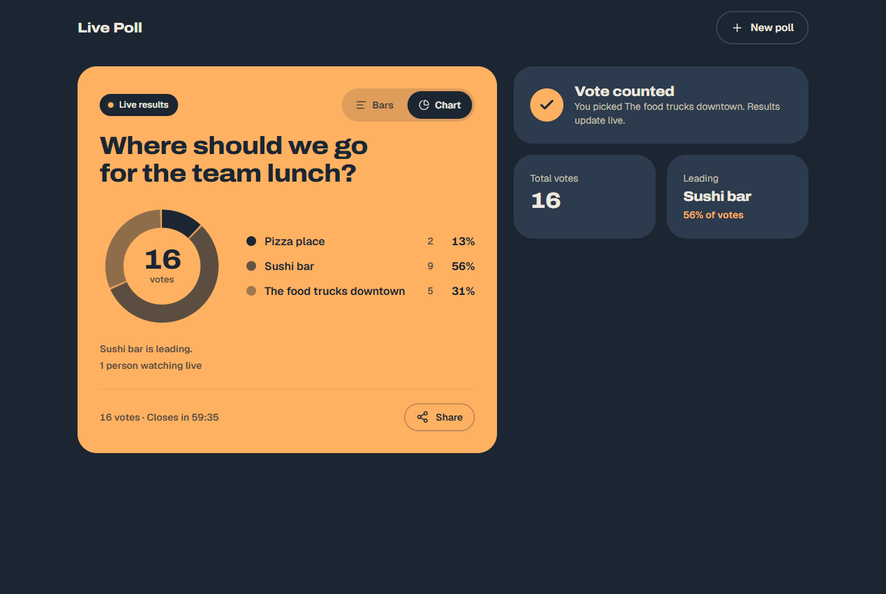
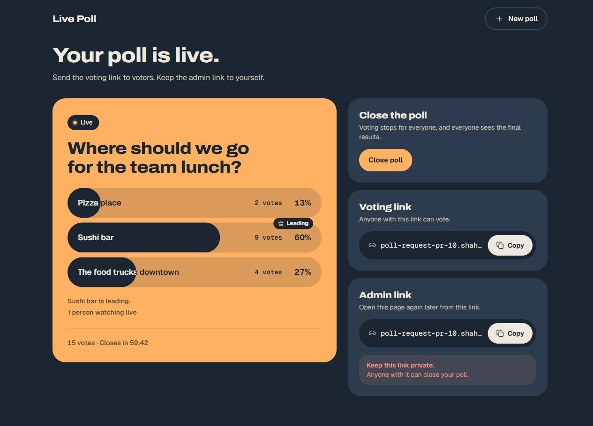

# How it works

## The life of a poll

1. **Create.** You write a question, add 2 to 5 answers, pick a color, and pick a time limit (1 minute to 24 hours).
2. **Share.** You get two links:
   - the **voting link**, which you send to people;
   - the **admin link**, which you keep. It lets you close the poll early.
3. **Vote.** Each person can vote once, and a vote can't be changed.
   Before voting, people only see how many votes there are, not who is winning.
4. **Watch.** After voting, people see the results, and the results update live as others vote.
5. **Close.** When the time is up (or you close it), the poll stops taking votes.
   Now everyone with the link can see the final results.
6. **Clean up.** Seven days after closing, the poll is deleted.
   Its final numbers are saved first in a small summary table.

## The screens

| Create | Vote |
| --- | --- |
|  |  |
| **Results** | **Manage** |
|  |  |

| Screen | Address | Who sees it |
| --- | --- | --- |
| Create | `/` | Everyone |
| Vote | `/pr/{pollId}` | Anyone with the voting link |
| Results | `/pr/{pollId}/results` | People who voted, the creator, and everyone after the poll closes |
| Manage | `/pr/{pollId}/manage#{adminToken}` | Only the creator |

## The architecture

Everything runs on one Cloudflare Worker.

```
Browser ──pages and API──▶ Worker (TanStack Start)
   │                          │
   │                          ▼
   └──live updates──────▶ PollRoom (one per poll) ──final numbers──▶ D1 summary table
                            ├─ its own SQLite database: poll, answers, votes
                            ├─ the open live connections
                            └─ a timer that closes the poll and deletes it later
```

- **Worker.** Renders the pages on the server and answers the API.
- **PollRoom.** A Cloudflare Durable Object. Each poll gets its own, with its own small database.
  It handles one request at a time, so two votes can never clash.
- **Live updates.** Voters open a WebSocket to their poll's PollRoom.
  After each vote, the PollRoom sends the new numbers to everyone watching.
- **Timer.** Each PollRoom sets an alarm for its closing time, and another one to delete the poll 7 days later.
- **D1.** One shared table with a summary of every poll: counts and times, no questions and no voter IDs.

## The code

The repo is a pnpm workspace. Each feature lives in its own folder.

```
packages/domain/     The rules: is the poll open, is this vote allowed, who may see the counts.
packages/ui/         The design: buttons, cards, and the poll screens.
apps/web/src/
  slices/            One folder per feature: create-poll, cast-vote, view-results, live-results, close-poll.
  poll-room/         The PollRoom and its database code.
  platform/          Shared helpers: cookies, rate limits, security headers, the live connection.
  routes/            The pages. Each one hands off to one feature folder.
```

`pnpm check:slices` makes sure feature folders don't import each other, and that the rules folder stays free of side effects.

## The data

Each PollRoom has its own SQLite database with three tables:

```sql
CREATE TABLE poll (
  id                  TEXT PRIMARY KEY,
  question            TEXT NOT NULL,
  tone                TEXT,              -- the card color
  admin_token_hash    TEXT NOT NULL,     -- a hash of the admin token; the token itself is never stored
  created_at          INTEGER NOT NULL,
  closes_at           INTEGER NOT NULL,  -- when the time limit ends
  closed_at           INTEGER,           -- set when the creator closes early
  summary_exported_at INTEGER,           -- set once the final numbers are saved to D1
  CHECK (closed_at IS NULL OR closed_at <= closes_at)
);
CREATE TABLE option (id INTEGER PRIMARY KEY, label TEXT NOT NULL, position INTEGER NOT NULL);
CREATE TABLE vote (
  voter_id  TEXT PRIMARY KEY,            -- one vote per voter
  option_id INTEGER NOT NULL REFERENCES option(id),
  voted_at  INTEGER NOT NULL
);
CREATE INDEX vote_by_option ON vote(option_id);
```

In a single shared database, the same tables would just have a `poll_id` column.
Here each poll has its own database, so that column isn't needed.

The D1 table `poll_summary` keeps one row per poll: when it opened and closed, who closed it, and the final count for each answer.
